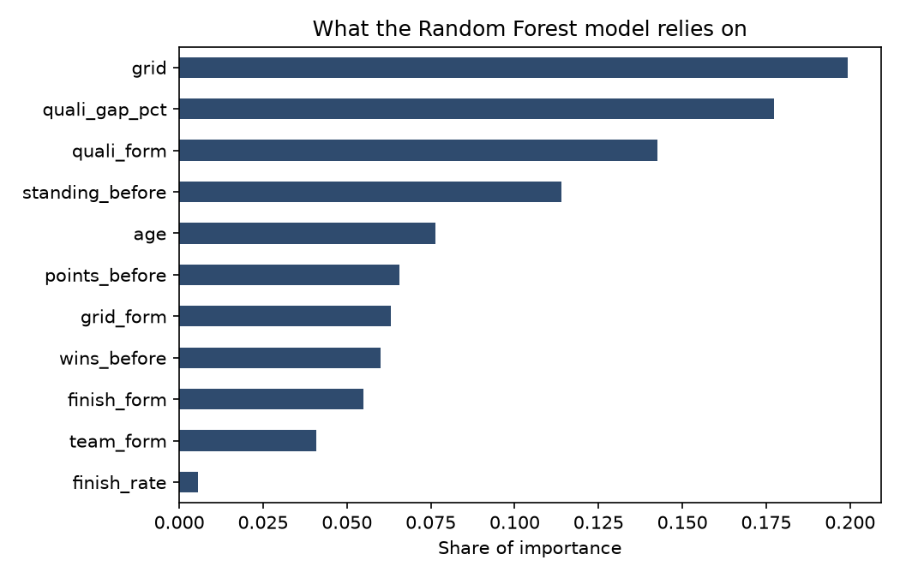

# 🏎️ Formula 1 Winners Prediction (2014 - 2021)

Peut-on prédire le vainqueur d'un Grand Prix de l'ère hybride V6 Turbo (2014-2021) avec uniquement ce que l'on sait **avant le départ** : la grille, les qualifications, le championnat en cours et la forme récente ?

---

## 📌 Le défi

Un seul vainqueur par course pour une vingtaine de pilotes : environ 95 % des lignes sont des « non-vainqueurs ». Un modèle qui répond toujours « non » a donc 95 % d'accuracy et ne sert à rien. Les modèles sont jugés sur deux choses :

1. **Par pilote** : précision, rappel et F1-score sur la classe vainqueur.
2. **Par course** : dans chaque Grand Prix, le pilote avec la plus forte probabilité est le vainqueur prédit. Combien de courses le modèle trouve-t-il, comparé à la règle la plus simple, « le poleman gagne » ?

Entraînement : saisons 2014 à 2020. Test : 2021, jamais vue pendant l'entraînement ni le réglage.

---

## 📊 Données

* **[Jolpica F1 API](https://github.com/jolpica/jolpica-f1)** (remplaçant de l'API Ergast, fermée) : résultats, qualifications, classements pilotes et circuits. Les réponses sont mises en cache dans `data/raw/` (non versionné, re-téléchargé automatiquement).

---

## 🛠️ Variables (toutes connues avant le départ)

* **`grid`** : position sur la grille de départ.
* **`quali_gap_pct`** : écart du meilleur tour de qualification au temps de la pole, en %.
* **`points_before`, `wins_before`, `standing_before`** : classement du championnat **avant** la course (celui publié après la manche précédente).
* **Forme récente**, moyennes sur les 3 courses précédentes : grille, écart en qualifications, position d'arrivée, taux d'arrivée.
* **`team_form`** : meilleure position de l'écurie sur ses 3 courses précédentes.
* **`age`** du pilote.

---

## 🚀 Résultats sur la saison 2021

Hyperparamètres réglés uniquement sur 2014-2020, avec des validations dans le temps (2018, 2019, 2020) notées en average precision. Le modèle retenu est celui qui fait le mieux en validation : **Random Forest**.

| Modèle | Courses trouvées | Précision | Rappel | F1 |
| :--- | :---: | :---: | :---: | :---: |
| Le poleman gagne (référence) | 11/22 | | | |
| **Random Forest (retenu)** | **12/22** | **0.75** | 0.27 | 0.40 |
| CatBoost | 13/22 | 0.59 | 0.45 | 0.51 |
| Régression logistique | 12/22 | 0.62 | 0.23 | 0.33 |
| Gradient Boosting | 11/22 | 0.64 | 0.32 | 0.42 |
| AdaBoost | 12/22 | 0.00 | 0.00 | 0.00 |

* Le modèle retenu trouve **12 vainqueurs sur 22**, un de plus que la règle du poleman. Quand il donne une probabilité d'au moins 0,5, il a raison **3 fois sur 4**, mais il n'atteint ce niveau de confiance que pour 6 des 22 vainqueurs.
* CatBoost fait mieux sur 2021, mais pas en validation : le retenir reviendrait à choisir le modèle sur la saison de test.
* Les variables les plus utiles : la grille, l'écart en qualifications, puis la forme récente en qualifications et la place au championnat.



> **Corrections par rapport à la première version** : source de données (API Ergast fermée, scraping Formula1.com cassé), jointure des qualifications par pilote et non par place sur la grille, suppression des variables connues seulement après la course (`status_id`, ratio de victoires calculé sur toutes les saisons dont 2021), réglage des modèles sans toucher à la saison de test, évaluation par course avec une référence, et cellules qui plantaient quand on exécutait le notebook dans l'ordre. Les chiffres de la première version (précision 0,69 avec CatBoost) étaient gonflés par ces erreurs.

---

## ⚙️ Installation et utilisation

```bash
git clone https://github.com/AlexandreBurhan/Formula-1-Winners-prediction.git
cd Formula-1-Winners-prediction
pip install -r requirements.txt
jupyter notebook Formula1CodeAlex.ipynb
```

Le premier lancement télécharge les données (quelques minutes, l'API limite le nombre de requêtes) ; les suivants utilisent le cache.
